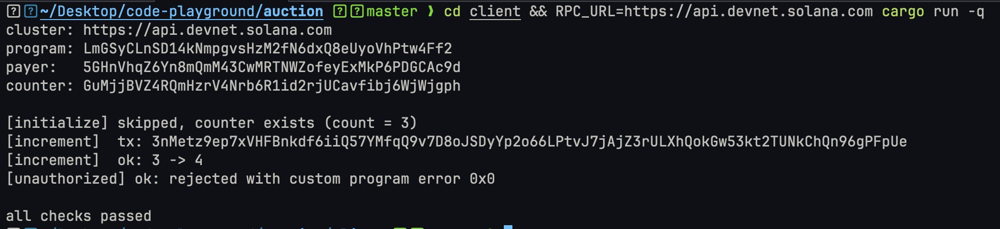

# auction

A Pinocchio 0.12 counter program on Solana, built as **SBPF v3** and called with **v1 transactions**
(SIMD-0385). It is the scaffold for the auction program. [`guide.md`](guide.md) has the full
from-scratch setup, version reasoning, and troubleshooting.



## Devnet

| | |
|---|---|
| Program ID | [`LmGSyCLnSD14kNmpgvsHzM2fN6dxQ8eUyoVhPtw4Ff2`](https://explorer.solana.com/address/LmGSyCLnSD14kNmpgvsHzM2fN6dxQ8eUyoVhPtw4Ff2?cluster=devnet) |
| Binary | 8,936 bytes, SBPF v3 (`0300 0000` at `0x30`). Built before `Deposit`/`Withdraw` were added; redeploy to get them |
| Upgrade authority | `5GHnVhqZ6Yn8mQmM43CwMRTNWZofeyExMkP6PDGCAc9d` |

## Program

Counter PDA seeds: `["counter", authority]`. The vault is any SPL Token account whose owner is
the counter PDA (for example the PDA's ATA); the client creates it.

Instruction data is `[discriminator, args...]`. Each processor in `program/src/instructions/`
documents its accounts, arguments, and errors.

| Discriminator | Instruction | Args | Accounts |
|---|---|---|---|
| `0` | `Initialize` | none | `[signer, writable] authority`, `[writable] counter PDA`, `[] system program` |
| `1` | `Increment` | none | `[signer] authority`, `[writable] counter PDA` |
| `2` | `Deposit` | `amount: u64` LE | `[signer] depositor`, `[writable] source`, `[] counter`, `[writable] vault`, `[] token program` |
| `3` | `Withdraw` | none | `[signer, writable] authority`, `[] counter`, `[writable] vault`, `[writable] destination`, `[] token program` |

`Withdraw` signs as the counter PDA to transfer the whole vault balance to `destination`, then
closes the vault and returns its rent to the authority.

Counter account (48 bytes, alignment 1):

| Offset | Size | Field |
|---|---|---|
| 0 | 1 | discriminator (`1`) |
| 1 | 1 | bump |
| 2 | 6 | padding |
| 8 | 32 | authority |
| 40 | 8 | count (`u64` little-endian) |

Errors (`custom program error: 0x<code>`):

| Code | Name | When |
|---|---|---|
| `0x0` | `Unauthorized` | Signer is not the counter's authority |
| `0x1` | `Overflow` | `count` would exceed `u64::MAX` |
| `0x2` | `InvalidVault` | Vault is not an SPL Token account owned by the counter PDA |
| `0x3` | `ZeroAmount` | Deposit amount is 0 |

## Layout

```
auction/
├── rust-toolchain.toml   host rustc 1.99.1
├── Cargo.toml            workspace: program only
├── program/              on-chain code (pinocchio, no Agave crates)
├── tests/                own workspace + Cargo.lock: LiteSVM 0.18.1, Agave 4.3.x
└── client/               own workspace + Cargo.lock: RPC client, Agave 4.4.x
```

`tests/` and `client/` are separate workspaces because LiteSVM and the RPC client need
incompatible Agave versions (`guide.md` §2).

## Requirements

| Tool | Version |
|---|---|
| Agave CLI / `cargo build-sbf` | 4.4.0 / 4.5.0 (4.1.2 works with `--arch v3`) |
| platform-tools | v1.58 |
| host rustc | 1.99.1 (pinned by `rust-toolchain.toml`) |
| surfpool | 1.7.0 (local node) |

```sh
agave-install init 4.4.0
curl -sL https://run.surfpool.run/ | bash
```

## Build

```sh
cargo build-sbf --tools-version v1.58 --arch v3
xxd -s 0x30 -l 4 target/deploy/auction.so   # 0300 0000 = v3
```

`target/deploy/auction-keypair.json` is the program ID. `cargo clean` deletes it, so back it up.

## Test (LiteSVM)

```sh
cd tests && cargo test
```

12 tests run the `.so` with v1 transactions: initialize, double initialize, foreign PDA, increment,
unauthorized increment, overflow, the v1 compute-unit limit, deposit, deposit into a vault the
counter doesn't own, zero deposit, withdraw (tokens out, vault closed, rent returned), and
unauthorized withdraw. Token transactions load the SPL Token program (~131 KB), so they use a
256 KiB loaded-accounts limit instead of 64 KiB.

## Run locally (surfpool)

```sh
# terminal 1, project root
surfpool start --offline --no-deploy

# terminal 2, project root
solana program deploy -u localhost target/deploy/auction.so \
  --program-id target/deploy/auction-keypair.json
cd client
cargo build    # first build compiles ~300 crates
cargo run -q
```

The client initializes the counter (skipped if it already exists), increments it, checks the new
value, and checks that a different signer is rejected with `0x0`.

| Variable | Default |
|---|---|
| `RPC_URL` | `http://127.0.0.1:8899` |
| `KEYPAIR` | `~/.config/solana/id.json` (fee payer and counter authority) |
| `PROGRAM_ID` | pubkey of `target/deploy/auction-keypair.json` |

## Deploy to devnet

```sh
solana program deploy -u devnet target/deploy/auction.so \
  --program-id target/deploy/auction-keypair.json
cd client && RPC_URL=https://api.devnet.solana.com cargo run -q
```

The screenshot at the top is the `cargo run -q` step on devnet (the counter already existed, so
`initialize` was skipped).
